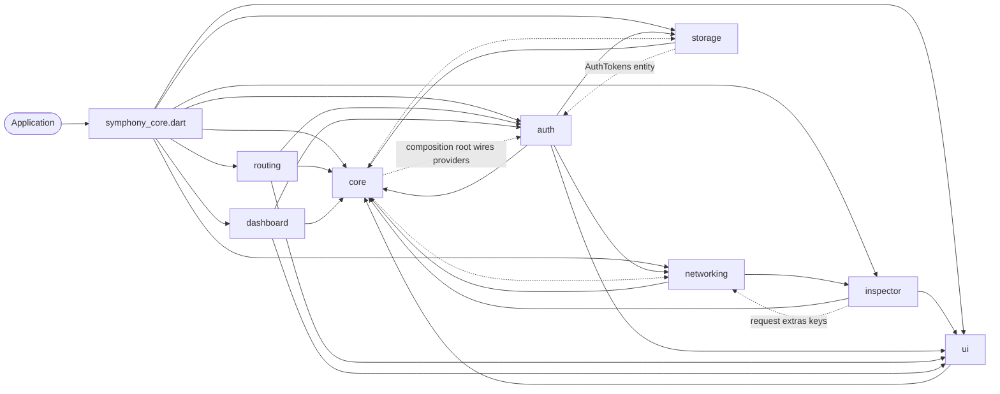
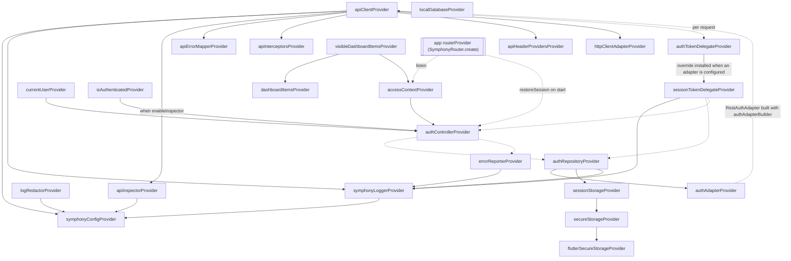
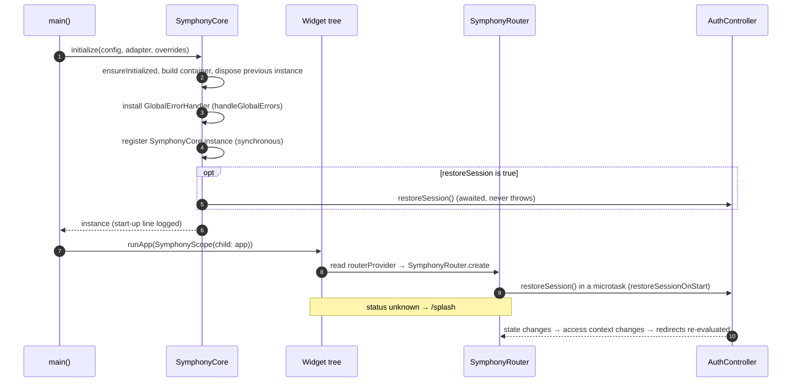
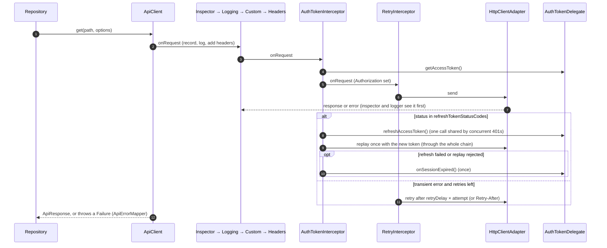
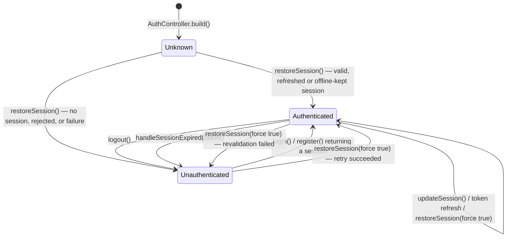
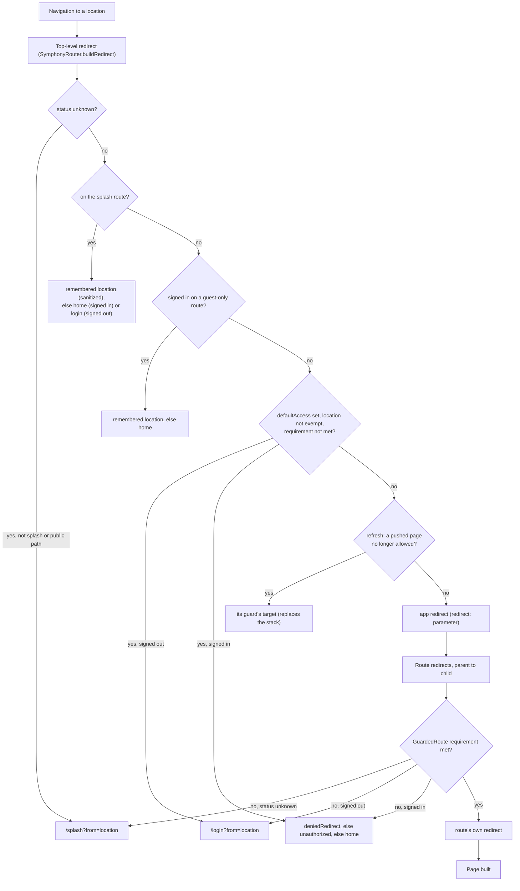

# Architecture

This document explains how symphony_core is organised and how its parts
interact at runtime. For usage, see the [README](../README.md).

- [Principles](#principles)
- [Layers and rules](#layers-and-rules)
- [Module dependency graph](#module-dependency-graph)
- [Composition root and DI](#composition-root-and-di)
- [Provider graph](#provider-graph)
- [Start-up sequence](#start-up-sequence)
- [HTTP request lifecycle](#http-request-lifecycle)
- [Authentication state machine](#authentication-state-machine)
- [Routing redirect flow](#routing-redirect-flow)
- [Extension points](#extension-points)
- [Compatibility layer](#compatibility-layer)

## Principles

- **Apps configure, the package implements.** Applications supply a
  `SymphonyConfig` and adapters (`AuthAdapter`, optional storage, error
  reporter, mappers...). They never edit package code, and nothing in the
  package is specific to one backend or project: no endpoint, response
  format or business rule is hard-coded.
- **Everything is a provider.** Every service is a Riverpod provider created
  lazily in one container, so any service can be replaced with an override
  (see [Extension points](#extension-points)).
- **Errors are values.** Infrastructure errors (Dio, platform channels,
  parsing) are converted to `Failure`s in the data layer. Repositories return
  `Result<T>` or throw `Failure`s; widgets never see `DioException` or
  `PlatformException`.
- **One public library.** `package:symphony_core/symphony_core.dart` exports
  the module barrels; `lib/src/` is private.
- **One codebase for a wide version range** (Flutter 3.29 → 3.44, Riverpod
  3.x, go_router 10 → 18); see [Compatibility layer](#compatibility-layer).

## Layers and rules

Each feature module (`lib/src/features/<module>/`) has three layers:

| Layer | Contains | Depends on |
|---|---|---|
| `domain/` | Entities and value objects (`AuthSession`, `ApiCallRecord`, `DashboardItem`, `SymphonyRoutePaths`), contracts (`AuthAdapter`, `AuthRepository`, `AuthTokenDelegate`, `ApiErrorMapper`, `KeyValueStorage`, `SessionStorage`, `LocalDatabase`), pure rules (`SymphonyRedirectResolver`, `DashboardMenu`, `ApiCallFilter`, `CurlCommandBuilder`). | Dart and `package:flutter/foundation.dart` only (dashboard items also use `IconData`, `Color` and widget builders from `package:flutter/widgets.dart`). No Dio, Riverpod or plugins. |
| `data/` | Implementations of the contracts: `ApiClient` and its interceptors, `DefaultApiErrorMapper`, `RestAuthAdapter`, `InMemoryAuthAdapter`, `AuthRepositoryImpl`, `SessionTokenDelegate`, `SecureKeyValueStorage`, `SecureSessionStorage`, local databases, `ApiInspector`. | Its own domain, other modules' contracts and services (for example `RestAuthAdapter` calls the networking module's `ApiClient`), Dio (networking and inspector only), flutter_secure_storage (storage only). |
| `presentation/` | Riverpod providers, `Notifier`s (`AuthController`), widgets and screens. | Domain, data (to build the providers), the `ui` module. |

`lib/src/core/` is the shared kernel (configuration, errors, `Result`,
access rules, logging, utilities) plus the composition root (`SymphonyCore`,
`SymphonyScope`, `symphonyOverrides`). `lib/src/ui/` holds presentation-only
building blocks (theme, widgets, responsive helpers) and depends only on
core.

Rules enforced across the codebase:

1. Only the networking module (and the inspector's Dio interceptor) uses Dio.
   Repositories and adapters call `ApiClient`.
2. No backend endpoint, response shape or project assumption is hard-coded;
   everything is a parameter with a neutral default.
3. Widgets contain no business logic: they call controllers and providers
   (ephemeral UI state such as "submitting" or "obscure text" is fine).
4. Errors cross boundaries as `Failure`s; repository methods return
   `Result<T>` (built with `guardResult`).
5. Every user-facing default text is a constructor parameter (apps
   localize).
6. Imports inside `lib/` are relative; every public API has `///`
   documentation; `dart analyze --fatal-infos` must report nothing.
7. `lib/` never imports `dart:io` (keeps web builds possible) and only uses the API subset
   available across the supported versions.

## Module dependency graph

Solid arrows are regular dependencies; dashed arrows are narrow ones:

- **core → auth / networking / storage**: only the composition root
  (`SymphonyCore`, `symphonyOverrides`) references feature providers, to wire
  them. The rest of core (config, errors, `Result`, access, logging, utils)
  depends on nothing but Flutter and Riverpod.
- **inspector → networking**: the inspector interceptor reads the per-request
  keys of `SymphonyRequestExtras` (for `inspect: false`). In the other
  direction, `ApiClient` installs the inspector interceptor.
- **storage → auth**: `SessionStorage` persists the auth domain's
  `AuthTokens`.
- **routing / dashboard → auth**: they read `accessContextProvider` (and the
  router calls `AuthController.restoreSession`). Their logic is written
  against `AccessContext`, so `SymphonyRouter.custom` and explicit
  `accessContext:` parameters work without the auth module.

External packages per module: Dio in networking and inspector;
flutter_secure_storage in storage; go_router in routing and dashboard
(navigation); Riverpod everywhere except `domain/` and `ui`.

## Composition root and DI

`SymphonyCore` owns one Riverpod `ProviderContainer`:

- `SymphonyCore.initialize` / `create` build it from `symphonyOverrides(...)`:
  `symphonyConfigProvider` ← config; `authAdapterProvider` ← adapter (value or
  builder) and `authTokenDelegateProvider` ← `sessionTokenDelegateProvider`
  when an adapter is given; `secureStorageProvider`, `localDatabaseProvider`
  and `errorReporterProvider` when given; then the app's overrides, last.
- `SymphonyScope` is an `UncontrolledProviderScope` over that container, so
  widgets use the regular Riverpod APIs. Apps can instead put
  `symphonyOverrides(...)` in their own root `ProviderScope`.
- Providers declare no Riverpod `dependencies`. Riverpod therefore keeps them
  in the root container of a hierarchy, and overrides only take effect in the
  root (not in nested scopes). This is why every override goes through
  `initialize(overrides:)` or the root `ProviderScope`.
- Duplicate overrides: `symphonyOverrides` drops a built-in override when
  the app overrides the same provider (it reads `Override.origin`), so the
  app's override applies and Riverpod's duplicate-override assertion is
  never hit.

Services are created lazily and disposed with the container: `ApiClient` is
closed (`ref.onDispose(client.close)`), the `ApiInspector` and the local
database are disposed, and the app's router provider disposes its router.

## Provider graph

Solid arrow: `A --> B` means A watches B (A is rebuilt when B changes).
Dashed arrow: B is read lazily (at call time) or listened to.

The `ApiClient → token delegate → repository → adapter → ApiClient` loop
is not a provider cycle: `apiClientProvider` resolves the delegate on each
request through its container (`ref.container.read`), and the delegate
resolves the repository and controller inside its callbacks. Using
`ref.read` there would make Riverpod report a circular
dependency in debug builds.

## Start-up sequence

`ApiClient` and the other services are built on first use, not during
`initialize`.

## HTTP request lifecycle

Dio runs interceptors in the same order for requests, responses and errors:

0. an internal interceptor applying per-request timeouts (including the
   connect timeout);
1. `ApiInspectorInterceptor` (when `enableInspector`): records the call, then
   completes it with the final headers, status and body;
2. `SecureLoggingInterceptor` (when `enableLogging`): redacted request,
   response and error lines;
3. custom interceptors (`apiInterceptorsProvider`, then `addInterceptor`);
4. `HeadersInterceptor`: dynamic header providers (per-request headers
   still win);
5. `AuthTokenInterceptor`: adds `<authTokenPrefix> <token>` from the
   `AuthTokenDelegate`, waits while a refresh is running, refreshes on
   `refreshTokenStatusCodes`;
6. `RetryInterceptor`: retries transient failures of idempotent requests.

Details:

- A replay or retry goes through the whole chain again: the inspector
  records it as a new call, after the failed attempt, and the logger marks
  it `(retry #n)` or `(replayed after token refresh)`.
- Requests with `requiresAuth: false`, a caller-set authorization header or a
  stream body are never refreshed; stream bodies are never retried.
- Requests issued from inside `refreshAccessToken` / `onSessionExpired` never
  wait for a refresh (zone-based guard), so a refresh cannot deadlock or loop.
  Auth endpoints use `ApiRequestOptions.unauthenticated`.
- With the auth module, `onSessionExpired` calls
  `AuthController.handleSessionExpired`, which clears the session; the
  router then redirects to the login page.
- Errors are converted by the `ApiErrorMapper` after the interceptor chain;
  the caller receives a `Failure`.

## Authentication state machine

- `AuthState` has exactly three cases (`AuthUnknown`, `AuthAuthenticated`,
  `AuthUnauthenticated`); progress of individual actions is returned by the
  futures of `AuthController`, not stored in the state.
- `restoreSession()` is single-flight and a no-op once the state is known,
  unless `force: true`. A slow restoration never overwrites a newer state.
- `AuthUnauthenticated.failure` explains why a session ended (for example
  `UnauthorizedFailure` after a rejected refresh).
- `accessContextProvider` maps the states to `AccessContext.unknown`,
  `AccessContext.unauthenticated` or the session's roles, permissions and
  user data.
- Storage writes are serialized and versioned, so a refresh completing after
  `logout()` cannot bring the session back.

## Routing redirect flow

- Every redirect result is a new location, evaluated again from the top (up
  to `redirectLimit`). Some go_router 17.0.x releases evaluate the top-level
  redirect only once per navigation; the built-in rules are idempotent so the
  flow still resolves.
- `GuestRoute` replaces the guard step with "signed in → authenticatedRedirect,
  else remembered location, else home".
- `defaultAccess` (optional, secure by default) exempts the splash route, the
  guest-only routes and `publicPaths`; signed-in users who do not satisfy it
  can still open the unauthorized route. With a `defaultAccess`, the
  location returned by the app redirect is checked against it as well, so
  every result of the global redirect is final.
- On a refresh, pages opened with `push` are re-checked by the global
  redirect (go_router 13+ would only re-evaluate the page below them).
- `refreshListenable` (fed by `accessContextProvider`) re-runs the redirects
  of the current location whenever the access changes: sign-in, sign-out,
  role changes, session expiry.
- `from` values are only followed when they are in-app paths (single leading
  `/`, no scheme, host, backslash or control character, not the splash or
  login route).
- The rules live in `SymphonyRedirectResolver`, a pure class with no
  `BuildContext`; `GuardedRoute` / `GuestRoute` find their router's access
  source through the context go_router passes to every redirect.

## Extension points

| Need | Extend or implement | Plug in through | Default |
|---|---|---|---|
| Backend authentication | `AuthAdapter` | `authAdapter:` / `authAdapterBuilder:` | none |
| REST response shapes | `AuthResponseMapping`, body and `parse…` hooks | `RestAuthAdapter` parameters | common shapes |
| Business rules on sessions | `sessionValidator` / `AuthAdapter.validateSession` | adapter | accept |
| Token source without the auth module | `AuthTokenDelegate` | `authTokenDelegateProvider` | `null` |
| Error payloads, localized errors | `ApiErrorMapper` / subclass of `DefaultApiErrorMapper` | `apiErrorMapperProvider` | `DefaultApiErrorMapper` |
| HTTP pipeline | Dio `Interceptor` | `apiInterceptorsProvider`, `ApiClient.addInterceptor` | none |
| Dynamic headers | `HeaderProvider` | `apiHeaderProvidersProvider`, `addHeaderProvider` | none |
| Transport, mocks, pinning | `HttpClientAdapter` | `httpClientAdapterProvider` | Dio default |
| Existing Dio instance | `ApiClient(dio: ...)` | `apiClientProvider` override | new `Dio` |
| Secrets backend | `KeyValueStorage` | `secureStorage:` / `secureStorageProvider` | `SecureKeyValueStorage` |
| Session persistence | `SessionStorage` | `sessionStorageProvider` | `SecureSessionStorage` |
| Local data | `LocalDatabase`, `LocalStore`, `StorageCodec` | `localDatabase:` / `localDatabaseProvider` | `InMemoryLocalDatabase` |
| Crash reporting | `ErrorReporter` | `errorReporter:` | `LoggerErrorReporter` |
| Log destinations | `LogSink` | `symphonyLoggerProvider` override | `DebugPrintLogSink` |
| Masked keys | `sensitiveKeys`, `LogRedactor` | `SymphonyConfig`, `logRedactorProvider` | default keys |
| Access rules | `AccessRequirement` (`predicate`) | `GuardedRoute`, `DashboardItem.access`, `AccessGate` | authenticated / public |
| Secure-by-default routing | `AccessRequirement` | `SymphonyRouter.create(defaultAccess:)` | `null` (only guarded routes) |
| App-wide redirect rules | `GoRouterRedirect` | `SymphonyRouter.create(redirect:)` | none |
| Access source without Riverpod | `readAccess` + `refreshListenable` | `SymphonyRouter.custom` | — |
| Menu content | `List<DashboardItem>` | `dashboardItemsProvider` | empty |
| Tile appearance | `DashboardTileBuilder` | `SymphonyDashboard.tileBuilder` | `SymphonyDashboardTile` |
| Splash body | `SymphonySplashBuilder` | `SymphonySplashScreen.builder` | built-in |
| Theme | `SymphonyThemeConfig`, `ThemeExtension`s | `SymphonyTheme.light/dark` | indigo seed |
| Breakpoints | `SymphonyBreakpoints` | `SymphonyBreakpointsScope` | 600 / 840 / 1200 |
| Password rules | subclass of `PasswordStrengthEvaluator` | `strengthEvaluator:` | built-in heuristic |
| Texts | `String` parameters, `ApiInspectorStrings` | widget constructors | English |

## Compatibility layer

The package targets Flutter 3.29 (Dart 3.7) → 3.44, Riverpod 3.x
(flutter_riverpod 3.0.1 and later) and go_router 10 → 18 with one codebase:

- **API subset.** Only APIs present at both ends are used: `Provider`,
  `NotifierProvider`, `FutureProvider`, `StreamProvider`, `ref.watch` /
  `read` / `listen` / `onDispose`, `ProviderContainer`,
  `UncontrolledProviderScope`; `GoRouter`, `GoRoute`, `ShellRoute`,
  `StatefulShellRoute`, `GoRouterState.uri`; Material 3 widgets that exist in
  3.29 and are not deprecated in 3.44; Dart 3.7 language features (wildcard
  `_` parameters, but no dot shorthands).
- **Riverpod types.** Riverpod 3 exports `Override` and `ProviderListenable`
  from `package:flutter_riverpod/misc.dart`, not from `flutter_riverpod.dart`;
  the internal `lib/src/core/di/riverpod_compat.dart` re-exports them from
  that public library (no import of Riverpod's `src/` internals).
- **Runtime probing.** `symphonyOverrides` reads `Override.origin`
  dynamically to remove duplicates: `Override` only declares `origin` from
  Riverpod 3.3 on (earlier 3.x releases declare it on the concrete override
  classes).
- **No version-specific framework hooks.** Where a feature would need an API
  that is missing at one end, the package leaves the hook to the app and
  documents it (for example the system back button, wired by the app with
  `PopScope`).

The verified matrix and the version-specific behaviours are listed in
[COMPATIBILITY.md](../COMPATIBILITY.md).
